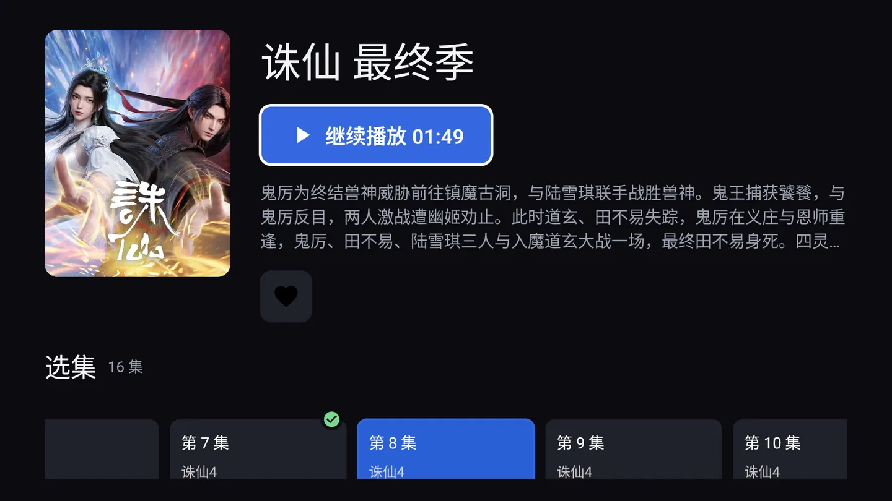
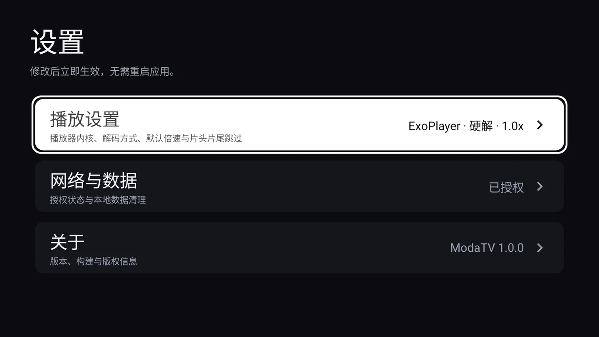
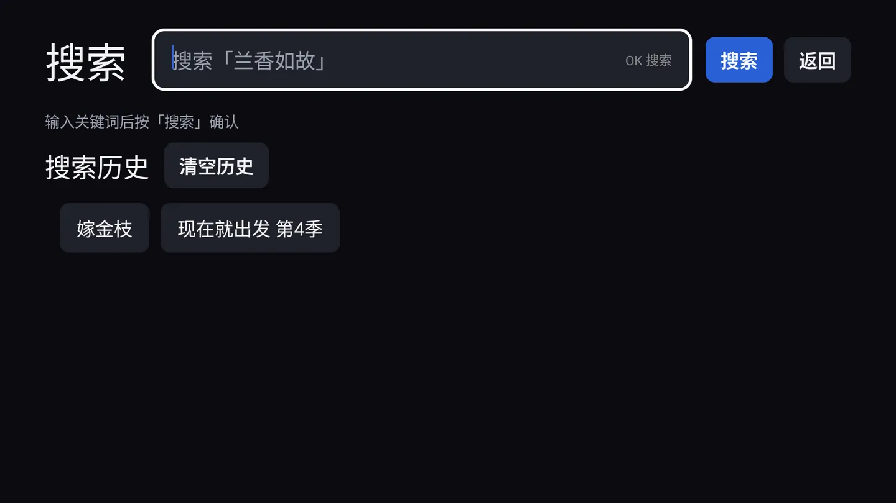

# ModaTv

一个为 Android TV / 电视盒子编写的腾讯视频聚合客户端：Kotlin + Jetpack Compose for TV，
遥控器全键位可操作，D-Pad 驱动的自绘播放器 OSD，支持内核与硬解/软解切换、清晰度切换、
选集、倍速、弹幕、画面比例与片头片尾自动跳过。

> 本项目是一个**非官方的第三方前端**，数据来自用户自行配置的后端代理接口与 v.qq.com 的公开页面。
> 仅用于学习与个人使用，请自行确认内容版权与所在地区法律法规。

---

## 界面

| 首页（19 个分类 tab，推荐 tab 末尾接「继续观看」） | 详情（续播按钮 + 单行选集轨道 + 已看完勾标） |
| --- | --- |
|  |  |

| 播放器 OSD（九个槽位，含内核 / 解码档位条） | 设置（菜单 + 三个分组子页，版权声明在「关于」里） |
| --- | --- |
|  |  |

| 收藏（追剧语义，点条目进详情） | 搜索（热词轮播 + 本地搜索历史） |
| --- | --- |
|  |  |

| 历史（最多 60 条，点条目直接续播） | 已看完（按集记录，点卡片从头重播） |
| --- | --- |
|  |  |

截图取自 1920×1080 的 Android TV 模拟器，覆盖全部八个页面。

---

## 功能

**首页**
- 19 个 tab：推荐 + 电视剧 / 电影 / 综艺 / 动漫 / 少儿 / 纪录片 / 精选 / 音乐 / 体育 /
  NBA / 游戏 / 汽车 / 时尚 / 生活 / 艺术 / 萌宠 / 播客 / 免费，顺序与 v.qq.com 导航栏一致
- 推荐 tab：抓 `https://v.qq.com/` 首页 HTML 里的 `/x/cover/<cid>` 链接（出现顺序即推荐位
  权重，实测上限 14 条），再拿 cid 回后端 `eps` 补全标题 / 竖版海报 / 简介 / 分类；
  横版剧照用第一集的 vid 拼，竖版与横版是两张不同的图
- 其余 18 个 tab：抓各自的 `https://v.qq.com/channel/<x>` 频道页，用同一条 `/x/cover/<cid>`
  正则提 cid，再走同一套 `eps` 补全——`CarouselSource.fetchCids` / `enrich` 是这两条路径
  共用的唯一实现，差别只有「抓哪个 HTML」，不是两套取数流水线
- 抓页面与补全都排在 4 个许可后面（`ChannelSource` / `CarouselSource` 的 `PARALLEL`，
  频道那条是**整页共享**、不是每频道各 4 路），tab 之间另有一道 6 路的闸
  （`HOME_TAB_PARALLEL`）：一次整页刷新是 19 个页面加上百个 cid 的补全，不设闸会瞬间打爆对端
- 继续观看：推荐 tab 末尾接一段「继续观看」（最多 5 条，同列宽网格；没有记录整段不出现），
  点卡片**直接进播放页**，不经过详情
- 数据源唯一：首页内容**只**来自 v.qq.com，没有搜索兜底。某个频道页抓不到就是这一屏为空，
  由持久化缓存顶上，而不是拿搜索结果冒充首页
- 缓存分层：每 tab 的快照落盘（`moda_home_cache`），任何异常都沿用过期的旧数据而不是让首页变空；
  进首页的自动刷新带 30 分钟门禁
- 工具栏时间读作两截：`上次刷新 今天 08:32` 是数据有多新，`现在 14:05` 是此刻几点。
  只给一个裸时刻（旧版是 `yyyy-MM-dd HH:mm`），读者分不清那是数据的年龄还是钟点
- 刷新按钮（工具栏最左）不判缓存时间、无条件整页重拉：过程中图标自转，结束后底部浮一条
  「刷新完成」/「刷新失败，已保留原有内容」，2.5 秒消失，脱离布局流也不进焦点链；
  刷新期间已有内容的 tab 保持原样，不置 loading、不闪列表
- 网格每行 5 张；一个 tab 一屏，不做分页（频道页没有可解析的分页结构）

**搜索**
- 腾讯热词接口（pbaccess）拉取热门词，10 分钟成功缓存 / 60 秒空结果缓存
- 本地搜索历史（DataStore 持久化）

**详情**
- 剧集元信息、全部分集（正片在前，预告片带「预告」角标，付费集带「VIP」）、每集自带的分集描述
- 主按钮按历史显示「继续播放 mm:ss」或「播放」；已看完的那一集不再显示断点
- 选集是一条**单行横向轨道**：左右键一路往右延伸，纵轴只留给整页滚动，
  不会出现两层都在吃上下键、焦点卡在边界不回头
- 轨道里是文字卡，不是缩略图：`第 N 集` 一行，有分集描述（综艺的当期看点）时
  卡片固定 190dp 宽、多画两行描述；没描述就收成一颗贴合文字的集号卡。
  用缩略图会把卡片撑到 100dp 以上，一屏只露一行，找集反而更慢
- 有观看记录时，记录的那一格进页即横向居中（靠近两端时退化为贴边，这是预期行为）；
  居中的是滚动位置不是焦点，首焦点仍在主按钮上
- 已看完的集在卡片右上角挂绿色勾标（骑在边框上，不压「第 N 集」那行字）
- 只有一集时不画「选集」整段：孤零零一个「第 1 集」只会让人以为还有别的集没加载出来
- 收藏 / 取消收藏（追剧语义，独立于播放历史）

**播放器**
- 内核可切换：Media3 ExoPlayer（默认，先走所选档位的 MP4 直链，起播失败才切整片 m3u8
  HLS 兜底一次，避免两路地址来回循环）与 IJK（ffmpeg 软解，用于 Exo 解不动的老片）；
  解码可选硬解 / 软解
- 内核与解码在播放页里也能现场切：两个横向档位条槽位（`内核` / `解码`），左右键换值。
  两者都只能在构造播放器时决定，所以换一次就是「重建引擎 + 从当前进度续播」，
  进度不丢；写盘异步进行，按键不等 IO
- 这两个值只记在当前这部剧上（`moda_playback_override`，按 `cid`）：设置页那两个仍是
  所有剧的默认值。选回与默认相同的值就删键，回到「跟随默认」，不会把一部剧钉死
- 本机没有 IJK 原生库时，`内核` 面板里直接写明「选 IJK 实际仍按 ExoPlayer 播放」，
  不做静默回退——否则排查解码问题时会被这条假信息带偏
- 自绘 OSD，遥控器焦点由单一索引维护，不与 `PlayerView` 抢方向键：
  `清晰度 / 选集 / 倍速 / 弹幕 / 画面比例 / 内核 / 解码 / 片头 / 片尾` 最多九个槽位
  （没有集数表时选集不参与导航），上下切换槽位、确认展开面板
- 缓冲指示器：半透明深色圆底 + 白细环 + 90° 弧匀速转圈（900ms 一圈），不用三点跳动——
  点阵静止下来和卡死长得一样。短于 400ms 的缓冲不显示，显隐走淡入淡出（进场 160ms /
  退场 220ms），且只在已经出画面（片长已知）之后才出，起播阶段由 Loading 屏负责
- 播放 / 暂停：确认键；快进快退：左右键（OSD 功能栏展开时仍可快进）
- 快进反馈是屏幕中央一个箭头 + 累计秒数，1.2 秒消失，不弹整块 OSD；累计的是**实际位移**：
  被片头 / 片尾夹住时按 10 秒只走了 3 秒，提示就报 3 秒；到头时位移为 0，不 seek 也不飘数字
- 按键按「最上层接管」分层：浮窗展开后它就是最上层，按键先归它，不穿透到底下的进度条
- 浮窗按导航轴分派左右键：横向浮窗（倍速 / 画面比例 / 内核 / 解码）左右键换值、
  选集条左右键换集号（确认才真正切集）；纵向浮窗（清晰度 / 弹幕）左右键在本层无语义，
  静默不响应
- 横向浮窗里上下键表示「离开这一行」：先收起浮窗回控制条，再换槽位
- 返回键分层退出：先关面板 → 再关 OSD → 再离开播放页
- 片头 / 片尾：槽位短按记录当前位置（重按即重记）；只跳用户记录的点，没有记录就正常播
- 弹幕：Canvas 自绘轨道，滚动 + 顶部/底部固定三种模式，字号四档，六种显示区域，上下边距可分步微调
- 画面比例：原始比例 / 拉伸 / 铺满 / 16:9 / 4:3
- 档位容错：取不到 vkey 的档位进入 10 分钟黑名单自动隐藏，过期后自动恢复

**片头片尾与完成判定**
- 完成线：播放进度 ≥ 片长 95%，或触发跳片尾。结算只有 `TvViewModel.markCompleted` 一个入口，
  幂等；完成后该集从历史移出、写入「已看完」
- 记录点若落在片长 1% 以内视为误触、超过片长 10% 视为记错，均弃用（按没记录处理）；
  有效片尾必须 > 有效片头 + 60s 且 < 片长 95%，否则「宁可不跳」
- 全部是 `IntroOutroRules` 里的纯函数，不碰 Context / DataStore，可在 JVM 直接验证边界

**历史 / 收藏 / 已看完**
- 播放历史最多 60 条，按 `updatedAt` 倒序，点条目直接续播
- 收藏不设上限，点条目进详情
- 已看完：独立页面，按 `(cid, 集号)` 记录，卡片挂绿色勾标，点卡片从头重播；删除只删这一集
  （历史那边删的是整部剧）。清除播放记录**不**联动清已完成，两者是不同语义的数据

**设置**
- 菜单 + 三个子页：播放设置（内核 / 解码 / 默认倍速 / 自动跳片头片尾）、
  网络与数据（代理网址、扫码配置、恢复默认、数据清理）、关于（版本 / 构建号 / Android 版本 /
  分辨率，末行是版权声明入口）
- 菜单页只留三张「进去改东西」的分组卡：版权声明是一次性查看，不占菜单位，混进菜单会让
  「能改的」和「只能看的」两件事塌成一层
- 内核 / 解码的说明里写清了「这里是所有剧的默认值，播放页里改的只作用于当前这部剧」
- 文案全部走 string 资源（`res/values/strings_*.xml`，一个页面 / 模块一个文件、键名带前缀）：
  **只有中文资源，界面语言固定中文，不跟随系统语言**——`values/` 就是默认资源，任何语言
  环境下都会取到它；再加一份其它语言的资源只会让设置页独自变语言、与其它页面混排
- 数据层不再产出文案：`Repo` / `Api` / `PlayerEngine` 只抛 `AppError` / `PlayerError`，
  唯一翻译点是 `ui/components/ErrorText.kt`；播放内核、解码方式、弹幕字号 / 区域只持有
  `@param:StringRes` 资源 id，由 UI 层解析（枚举落盘仍是 `enum.name`，改文案不会让旧数据失联）
- 版权声明：「关于」子页最后一行的常驻入口，也是该页**唯一可聚焦的一行**——进页即把首焦点
  给它，下键不会在五行只读信息之间空转；每次版本升级后自动弹一次（判定按 `versionCode`，不用布尔开关）

---

## 技术栈

| 项目 | 版本 |
| --- | --- |
| Kotlin | 2.2.20（Compose Compiler Plugin） |
| Android Gradle Plugin | 8.9.3 |
| Gradle | 8.11.1 |
| compileSdk / targetSdk / minSdk | 35 / 34 / 23 |
| Java / Desugaring | 17 / desugar_jdk_libs 2.1.2 |
| Compose BOM | 2025.12.01 |
| media3 (ExoPlayer / HLS / UI / OkHttp) | 1.4.1 |
| androidx.tv:tv-material | 1.0.0 |
| IJK 内核 | xyz.doikki.android.dkplayer:player-ijk 3.3.7（native 按 ABI 裁剪到 arm64-v8a / armeabi-v7a） |
| OkHttp | 4.12.0 |
| DataStore Preferences | 1.1.7 |
| ZXing core | 3.5.3（仅生成二维码矩阵，不引 android-embedded） |

依赖全部显式写在 `app/build.gradle.kts`，未使用 version catalog。

---

## 构建与安装

前置：JDK 17、Android SDK（`local.properties` 中的 `sdk.dir` 指向本机 SDK）。

```bash
# 调试包
./gradlew assembleDebug

# 产物
app/build/outputs/apk/debug/app-debug.apk

# 安装到已连接的电视 / 盒子
adb install -r app/build/outputs/apk/debug/app-debug.apk
```

应用同时注册 `LEANBACK_LAUNCHER` 与 `LAUNCHER`：电视桌面走前者，手机/平板桌面与不带
`android.software.leanback` 的调试机走后者，两种设备都能看到图标。
界面固定横屏；leanback 仍为 `required=true`。
minSdk 23 覆盖大多数电视盒子；Android TV / Google TV 模拟器可直接运行。

---

## 后端代理

应用不自带任何接口地址：所有业务请求都发往**用户自建的代理后端**，地址在
「设置 → 网络与数据 → 代理网址」里填写，或用手机扫码在同一局域网内配置；出厂默认为空。

接口契约（请求路径、动作名、请求头、响应包装）**不随仓库发布**——需要自建后端时按自己的
服务实现对接，仓库里只保留调用方。

> 🔐 后端地址、设备令牌、指纹以及热词接口凭据都**不在仓库里**：
> 它们写在 `local.properties`（已 gitignore），构建期由 `app/build.gradle.kts`
> 注入成 `BuildConfig` 字段。首次检出请复制 `local.properties.example` 为
> `local.properties` 并填入自己的值；缺省为空串，应用会直接报请求失败。
> 自建后端时优先使用 HTTPS。

---

## 项目结构

```
AGENTS.md                         编码与协作的强制约定（分层、按键、兜底、存储、提交）
CONTRIBUTING.md                   提交信息规范（Conventional Commits + 钩子校验）

app/src/main/assets/index.html   手机端扫码配置页（LanConfigServer 读取后填充占位符）
app/src/main/res/values/strings.xml       通用文案：设置页 / 设置子页 / 错误提示 / 公共词
app/src/main/res/values/strings_*.xml     按模块拆分：core / data / data2 / detail / home /
                                          library / player / search / state
                                          （只有中文资源，界面语言固定中文，不跟随系统语言）

app/src/main/java/com/moda/tv/
├── ModaApp.kt              Application：启动前同步注入持久化的代理网址
├── MainActivity.kt         单 Activity，全屏沉浸 + Compose 入口
├── model/                  纯数据：VideoItem / Episode / Tier / LibraryEntry / HomeTab / HomeFeed
│                           AppError.kt：结构化错误码 AppError / PlayerError（不含界面文案）
├── data/
│   ├── Api.kt              后端 HTTP 调用，失败一律落成 AppError
│   ├── Repo.kt             业务门面：首页推荐/分类流、详情、播放计划、弹幕、热词、档位黑名单
│   ├── Parser.kt           接口 JSON → 模型的解析
│   ├── CarouselSource.kt   v.qq.com 首页推荐位 → cid 列表
│   ├── ChannelSource.kt    v.qq.com 频道页 → 19 个分类的内容
│   ├── FileName.kt         下载文件名清洗
│   ├── LanConfigServer.kt  局域网扫码配置的临时 HTTP 服务 + 二维码生成
│   └── local/              DataStore 存储（含按剧的内核 / 解码覆盖）+ 代理网址校验 + 片头片尾纯规则
└── ui/
    ├── AppRoot.kt          路由栈渲染 + 退出确认 + 版权声明弹窗
    ├── Destinations.kt     手写路由（不引 navigation-compose）+ 设置分组枚举
    ├── TvViewModel.kt      页面栈 + 各屏数据装载 + 播放器装配 + 完成结算
    ├── HomeScreen.kt       工具栏 + 19 个 tab + 网格 + 继续观看行
    ├── DetailScreen.kt     详情页头 + 单行选集轨道（有记录时居中）+ 已看完勾标
    ├── *Screen.kt          Search / Player / History / Favorites / Completed / Settings
    ├── SettingsSections.kt 设置三个子页的内容
    ├── components/         卡片、通用状态、最小 OkHttp 图片加载器（不引 Coil）
    │                       ErrorText.kt：错误码 → 界面文案的唯一翻译点
    ├── player/             OSD、选集 / 倍速 / 弹幕 / 画面比例面板、内核与解码档位条
    │                       （CorePanel）、Canvas 弹幕层、内核抽象
    └── theme/              颜色与字阶
```

分层与编码约定见 [AGENTS.md](AGENTS.md)：UI 只调 `Repo`，异常在 ViewModel 内落成状态。

---

## 本地存储

全部使用 DataStore Preferences，一个键缺失即代表「用户从未改过」，读不到时静默退回默认值：

| 文件 | 内容 |
| --- | --- |
| `moda_history` | 播放历史（最多 60 条） |
| `moda_favorites` | 收藏（不设上限） |
| `moda_completed` | 已看完（按 `cid + 集号` 记录，最多 500 条） |
| `moda_search_history` | 搜索历史 |
| `moda_home_cache` | 首页每 tab 的快照 + 上次整页刷新时刻 |
| `moda_intro_outro` | 每部剧的片头 / 片尾记录点 |
| `moda_player_settings` | 全局默认值：内核、解码、默认倍速、弹幕开关/字号/区域/边距、画面比例、跳片头片尾开关 |
| `moda_playback_override` | 每部剧在播放页单独设过的内核 / 解码（按 `cid`，最多 60 条 LRU；与默认值相同即删键；删历史 / 清空历史时连带清理） |
| `moda_api_settings` | 代理网址（键缺失 = 用出厂默认，因此「恢复默认」只是删键） |
| `moda_copyright_notice` | 已确认版权声明的 `versionCode` |

---

## 局域网扫码配置

电视上敲 URL 是反人类的，所以设置页提供一次性的手机端配置入口：

1. 打开「扫码配置代理网址」，弹出二维码；
2. 服务只在弹窗打开期间监听（默认 9999，被占用时顺延最多 20 个端口），关闭立即归还端口；
3. 手机浏览器打开二维码中的地址（或直接输入 `http://<电视IP>:9999`），输入新地址并提交；
4. 不做 token 校验——端口只在弹窗打开时监听，能连上就能改；
5. 校验、探活、落盘都由应用侧负责，服务本身只处理协议。

没有前台服务、没有常驻单例、没有延时回收——对象被丢弃即彻底消失。

手机端页面本身是 `app/src/main/assets/index.html`，**可以直接用浏览器双击打开预览样式**：
模板里的占位符要么写在 HTML 注释里、要么被一小段脚本清掉，直接打开不会看到 `__VALUE__` 这类字面量。

它只有两个占位符，`LanConfigServer.pageHtml` 负责替换：

| 占位符 | 替换成 |
| --- | --- |
| `<!--BANNER_SLOT-->` | 成功/失败提示条，无提示时为空串 |
| `__VALUE__` | 当前生效地址（已做 HTML 转义） |

表单的 `action` 固定为 `/save`，不再需要拼接。改文案或样式只动这个 HTML 文件；
两个占位符必须保留（提示条那块留空就等于没有提示）。资源读取失败时退回内置兜底页，不会白屏。

---

## 已知限制

- 依赖第三方后端与 v.qq.com 的页面结构，腾讯侧改版会导致某个分类 tab 为空
  （没有搜索兜底可退，这是有意的取舍：宁可空，也不拿别处的数据冒充首页）。
- 设备 token 有有效期，过期后所有业务接口都会返回 `ok=false`。
- IJK 只打包了 `arm64-v8a` / `armeabi-v7a`，x86 模拟器上不具备 IJK 内核（ExoPlayer 不受影响）。
- 界面语言固定中文，不跟随系统语言：系统语言不是中文时，界面仍然是中文。
- 未配置单元测试与持续集成，验证方式为真机/模拟器手动走查。

## 贡献

写代码前请先读 [AGENTS.md](AGENTS.md)（分层、遥控器纪律、降级兜底、存储约定）；
提交前请阅读 [CONTRIBUTING.md](CONTRIBUTING.md)。提交信息遵循 Conventional Commits：
`<type>(<scope>): <中文描述>`，例如 `fix(player): 修复倍速切换后画面卡顿`。

首次克隆后启用提交信息钩子（只需一次）：

```bash
git config core.hooksPath .githooks
```
